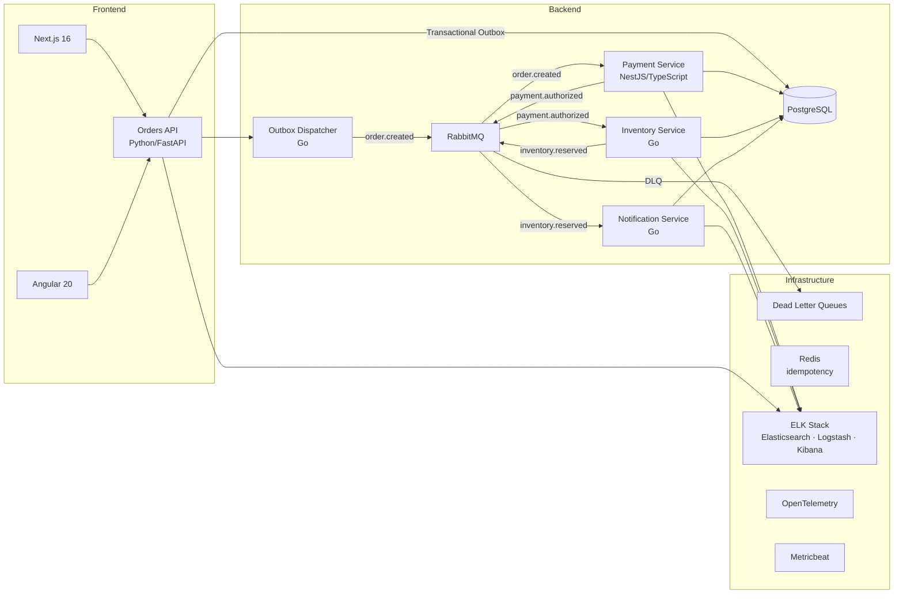

# Event-Driven Architecture — Order Processing System

A polyglot microservices system implementing a full e-commerce order flow (create → pay → reserve inventory → notify) using event-driven architecture, transactional outbox, and distributed tracing. Built as a portfolio project to demonstrate production-grade patterns across Python, Go, and TypeScript services with two modern frontend implementations.

## Architecture



All consumer services use Redis for idempotency and route failed messages to per-service DLQs after exponential-backoff retries. All RabbitMQ messages use `snake_case` field names ([ADR-05](docs/ADR-05-json-naming-convention.md)).

## Tech Stack

| Layer | Technology |
|-------|------------|
| Frontend | Next.js 16 (React 19, Server Components, TanStack Query), Angular 20 (Signals, Standalone Components, Angular Material) |
| Orders API | Python 3.11 / FastAPI — Clean Architecture, Transactional Outbox, Alembic migrations |
| Payment Service | TypeScript / NestJS 10 — Stripe simulation, TypeORM, structured logging |
| Consumers | Go 1.21 — inventory-service, notification-service, outbox-dispatcher (shared `go-shared` module) |
| Message Broker | RabbitMQ — topic exchange, per-service DLQs, exponential-backoff retry |
| Database | PostgreSQL — optimistic locking, materialized views |
| Cache | Redis — idempotency keys with TTL |
| Observability | OpenTelemetry (HTTP + AMQP spans), ELK Stack (Elasticsearch, Logstash, Kibana, Filebeat, Metricbeat) |
| Load Testing | k6 — ramp → 2 000 req/s plateau → decay, integrated via `scripts/monitor.sh` |
| DevOps | Docker Compose, GitHub Actions CI/CD, pre-commit hooks, Makefile |

## Key Architecture Decisions

| Decision | ADR | Rationale |
|----------|-----|-----------|
| Transactional Outbox Pattern | [ADR-01](docs/ADR-01.md) | Guarantees exactly-once event publishing without distributed transactions — order and outbox row written in the same DB transaction |
| DLQ + Retry Strategy | [ADR-02](docs/ADR-02.md) | Exponential backoff for transient failures; DLQ isolates poison messages for manual analysis without blocking the queue |
| OpenTelemetry + ELK | [ADR-03](docs/ADR-03.md) | Unified observability across polyglot services — correlated traces, structured logs, and metrics in one stack |
| k6 Load Testing | [ADR-04](docs/ADR-04.md) | Scripted scenarios with burst traffic and deliberate service failures; metrics exported to Elasticsearch for Kibana dashboards |
| snake_case on the wire | [ADR-05](docs/ADR-05-json-naming-convention.md) | Avoids per-field mapping surprises in a mixed Python/Go/TypeScript system — each service converts at its own boundary |

## Quick Start

```bash
make setup    # Copy .env.example files, install pre-commit hooks
make up       # Start all services via Docker Compose
```

Frontends:
- Next.js: http://localhost:3000
- Angular: http://localhost:4200

Infrastructure:
- RabbitMQ Management: http://localhost:15672 (order_user / order_password)
- Kibana: http://localhost:5601
- Orders API: http://localhost:8080/health/
- Payment Service: http://localhost:3001/health

## Project Structure

```
.
├── services/
│   ├── orders-api-python/       # Python/FastAPI — entry point, transactional outbox
│   ├── outbox-dispatcher/       # Go — polls outbox table, publishes to RabbitMQ
│   ├── payment-service-nestjs/  # TypeScript/NestJS — payment authorization
│   ├── inventory-service/       # Go — stock reservation
│   ├── notification-service/    # Go — email simulation
│   └── go-shared/               # Shared Go types and RabbitMQ helpers
├── fe-next/                     # Next.js 16 frontend
├── fe-angular/                  # Angular 20 frontend
├── config/                      # Logstash, Filebeat, Metricbeat, Kibana config
├── scripts/                     # DB init, RabbitMQ init, monitor (k6), git hooks
├── docs/                        # PRD, ADRs, Kibana filter reference
├── docker-compose.yml
└── Makefile
```

## Testing

```bash
make test              # All test suites
make test-python       # pytest — 44+ tests (unit + integration)
make test-go           # go test — inventory, notification, outbox-dispatcher
make test-nestjs       # Jest — payment service (27+ tests)
make test-frontend     # Vitest (Next.js) + Jest (Angular) — 37+ tests
```

## What This Demonstrates

- **Event-Driven Architecture** — transactional outbox guarantees no lost events even under partial failure
- **Polyglot backend** — Python, Go, and TypeScript services with consistent Clean Architecture layering
- **Resilience patterns** — idempotent consumers, exponential-backoff retry, DLQ isolation
- **End-to-end observability** — distributed traces (OTel) correlated with structured logs (ELK) across every service
- **Modern frontends** — Server Components + TanStack Query (Next.js), Signals + Standalone (Angular)
- **DevOps maturity** — multi-stage Docker builds, CI/CD, pre-commit hooks, Makefile-driven workflow
- **Performance target** — architecture validated at 2 000 req/s with P99 ≤ 200 ms and DLQ rate ≤ 0.1 %
